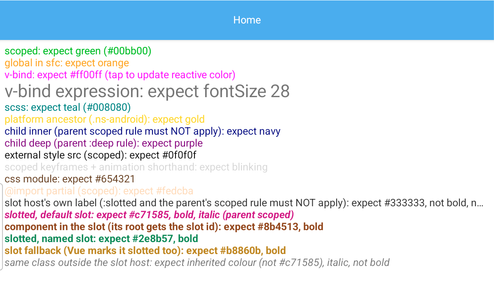

# Vue SFC styles on NativeScript

A proof-of-concept NativeScript-Vue 3 app for enabling Vue single-file-component `<style>`
features, with both the Vite and the webpack bundler.



## Why this exists

Vue components describe their styles in `<style>` blocks: scoped rules, `v-bind()` to drive CSS
from component state, CSS modules, SCSS, and so on. With NativeScript's Vite bundler, most of
this does not work during development
([NativeScript/NativeScript#11185](https://github.com/NativeScript/NativeScript/issues/11185)).
Under `ns run` and `ns debug`, styles come out unscoped, edits to them don't hot-reload properly,
and a component using `v-bind()` in CSS crashes. Some features also fail in production bundles.
With webpack, `v-bind()` in CSS crashes the app too, `<style module>` does nothing, and a
hot-edited stylesheet can start overriding rules it shouldn't.

This repo runs the app against improved builds of the packages involved, built from local
checkouts of the official repositories, and provides a test screen that shows at a glance
whether each feature works.

The goal is the get these features implemented upstream, so that patching isn't necessary.

So this serves as a starting point / source of inspiration for that work.

## Features

The app opens on a single screen. Each line on it is styled by one feature
and says what it should look like ("expect green", "expect blinking", …), so a wrong colour or a
missing effect points at a broken feature.

| Feature | Example |
| --- | --- |
| Scoped styles | `<style scoped>` rules apply to this component only and don't leak into children |
| `:deep()`, `:global()`, `:slotted()` | reach into a child, style globally, style content passed into a slot |
| `v-bind()` in CSS | `color: v-bind(color)`; tap the line to change the colour live |
| CSS modules | `<style module>`, used through `$style` |
| SCSS | `<style lang="scss">` with variables |
| `@import` and `<style src>` | styles pulled in from separate `.css` files |
| Scoped `@keyframes` | `animation:` shorthand with a keyframe defined in the component |
| Platform rules | `.ns-android` ancestor selectors |

Live editing is part of the test: with the app running under `ns run / ns debug`, changing any of these
styles must update the screen without a restart, replacing the old rules instead of piling up
on them.

## Running it

You need the [NativeScript CLI](https://docs.nativescript.org/setup/) and an Android device or
emulator. The app is built against the improved packages, which come from three checkouts next to
this project, in `../ns-css-improvements/integration/` (NativeScript, nativescript-vue and
tailwind); the dependencies point there with `file:` paths.

To create those checkouts from the forks that hold the changes, then build and install the
packages, run this instead of `npm install` (which fails until the checkouts exist):

```bash
npm run packages:setup
```

It clones the `sfc-styles-demo` branch of
[martinkruusement/NativeScript](https://github.com/martinkruusement/NativeScript),
[martinkruusement/nativescript-vue](https://github.com/martinkruusement/nativescript-vue) and
[martinkruusement/tailwind](https://github.com/martinkruusement/tailwind). Each of these branches
merges every pull request of the series into that repository's `main`.

If the checkouts already exist, rebuild and reinstall the packages with:

```bash
npm run local:update
```

This builds `@nativescript/core`, `@nativescript/vite`, `@nativescript/webpack` and
`nativescript-vue` from the checkouts and installs all the local packages. Run it again after
changing them: `npm install` alone keeps the copies it installed before.

| Script | Runs the app with |
| --- | --- |
| `npm run android:vite` | Vite, hot reload |
| `npm run android:vite:bundle` | Vite, regular bundle build (`--no-hmr`) |
| `npm run android:webpack` | webpack, hot reload |
| `npm run android:webpack:bundle` | webpack, regular bundle build (`--no-hmr`) |

`ios:` variants of the same four exist. The webpack build installs as a separate app
(`org.nativescript.vuesfcstylesdemo.webpack`), so both can stay on the device side by side.

With hot reload, check the probe screen, then edit a rule in
`app/components/sfc-style-tests/StyleProbe.vue` and watch it update. The bundle builds should
look the same as the hot-reload ones.

Part of the dev-server behaviour can also be tested without a device:

```bash
npm test
```

## How it works

The app itself is a stock NativeScript-Vue project. All the work is in the packages it is built
with:

| Package | What changes |
| --- | --- |
| `@nativescript/vite` | compiles `<style>` blocks properly for the dev server and for bundles, hot-reloads them, keeps the cascade order on hot updates, and fixes several dev-server issues |
| `@nativescript/webpack` | supports `<style module>`, keeps the cascade order on hot updates, and configures vue-loader 17 correctly |
| `nativescript-vue` | the `useCssVars` and `useCssModule` runtime helpers that `v-bind()` and CSS modules need, with either bundler |
| `@nativescript/core` | parses `animation:` shorthands whose keyframe name ends in a digit or contains a keyword |
| `@nativescript/tailwind` | keeps `animation:` declarations, which the Tailwind plugin otherwise deletes |

Each change is a separate commit, meant to become its own pull request to the official
repository.

## Where to find the details

| Path | Contents |
| --- | --- |
| [`app/components/sfc-style-tests/`](app/components/sfc-style-tests/README.md) | the probe components and tests, with a list of what each file covers |

## Status

Tested on an Android device (Android 16) with both bundlers, with hot reload and with bundle
builds. iOS has not been tested, though none of the changes is platform-specific. Each change is
proposed upstream as its own pull request, from a branch of the forks listed above.

## License

[MIT-0](LICENSE): use, copy and adapt anything here, upstream included, with no attribution
required.
